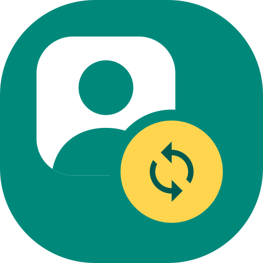

<p align="center">
  
</p>

<h1 align="center">PicSync</h1>

<p align="center">
  Übernimmt die WhatsApp-Profilbilder deiner Kontakte als Fotos ins Android-Telefonbuch – ohne Root.
</p>

---

> ⚠️ **Inoffizielles Projekt, Nutzung auf eigenes Risiko.** Siehe [Haftungsausschluss](#haftungsausschluss).

## Inhalt

- [Was macht die App?](#was-macht-die-app)
- [Wie funktioniert das ohne Root?](#wie-funktioniert-das-ohne-root)
- [Funktionen](#funktionen)
- [Download](#download)
- [Bauen](#bauen)
- [Installieren](#installieren)
- [Benutzung](#benutzung)
- [Verhalten im Detail](#verhalten-im-detail)
- [Daten & Privatsphäre](#daten--privatsphäre)
- [Fehlerbehebung](#fehlerbehebung)
- [Projektstruktur](#projektstruktur)
- [Architektur](#architektur)
- [Grenzen & Ideen](#grenzen--ideen)
- [Haftungsausschluss](#haftungsausschluss)
- [Lizenz](#lizenz)

## Was macht die App?

WhatsApp zeigt zu fast jedem Kontakt ein Profilbild, im Android-Telefonbuch fehlt es dagegen meist. PicSync gleicht das ab:

1. Die App liest die Telefonnummern aus deinem Telefonbuch.
2. Sie prüft, welche Nummern WhatsApp nutzen.
3. Sie lädt die Profilbilder in voller Auflösung.
4. In einer **Vorschau** siehst du altes und neues Bild nebeneinander und wählst aus, was übernommen wird.
5. Die ausgewählten Bilder schreibt sie als Kontaktfoto ins Telefonbuch, z. B. in deine Google-Kontakte, damit sie auch auf anderen Geräten erscheinen.

## Wie funktioniert das ohne Root?

WhatsApp speichert Profilbilder im privaten App-Speicher. Ohne Root kommt keine andere App dort heran.

PicSync geht deshalb einen anderen Weg und meldet sich wie **WhatsApp Web** als **verknüpftes Gerät** an deinem Account an. Dafür nutzt die App die Go-Bibliothek [whatsmeow](https://github.com/tulir/whatsmeow), die das Multi-Device-Protokoll von WhatsApp implementiert. Über diese Verbindung kann PicSync für jede Telefonnummer das Profilbild abfragen. Du siehst dabei genau die Bilder, die du auch in WhatsApp sehen würdest.

Weil die App auf demselben Handy läuft wie WhatsApp, lässt sich kein QR-Code scannen. Die Kopplung läuft deshalb über einen **8-stelligen Kopplungscode**, den du in WhatsApp eingibst.

Chatverläufe lädt PicSync nicht herunter, die Verlaufs-Synchronisation ist abgeschaltet.

## Funktionen

- 🔗 **Kopplung per Code** statt QR, direkt auf demselben Gerät
- 👀 **Vorschau mit Auswahlliste:** bisheriges Foto → WhatsApp-Bild, mit Status, Filtern und „Alle / Keine“
- 🧠 **Abgewählte merken:** Abgelehnte Vorschläge bleiben abgewählt, bis der Kontakt in WhatsApp ein neues Bild setzt
- ♻️ **Inkrementell:** Unveränderte Bilder werden nicht erneut heruntergeladen
- 🛡️ **Schonend:** Eigene Kontaktfotos werden standardmäßig nicht überschrieben, Anfragen an WhatsApp sind gedrosselt
- 🔔 **Vordergrund-Dienst:** Die Verbindung bleibt bestehen, während du in WhatsApp den Code eingibst. Der Code steht auch in der Benachrichtigung.
- 🎨 **Adaptives Icon** inklusive Themed-Icon-Variante für Android 13+

## Download

Ein fertiges APK gibt es unter **[Releases](https://github.com/sebastomat/picsync/releases/latest)**. Es läuft auf Android 8.0 oder neuer, auf arm64-Geräten.

Das APK ist mit einem Entwicklungsschlüssel signiert, nicht mit einem Store-Zertifikat. Android warnt deshalb bei der Installation („unbekannte Quelle“, ggf. Play Protect). Wer dem nicht vertraut, baut die App selbst (siehe unten).

## Bauen

### Voraussetzungen

| Werkzeug | Version | Hinweis |
|---|---|---|
| JDK | 17 | |
| Android SDK | Platform 36, Build-Tools 35+ | `local.properties` mit `sdk.dir=…` anlegen |
| Android NDK | r28 (getestet: 28.2.13676358) | für gomobile |
| Go | 1.24+ (getestet: 1.27.3) | z. B. nach `~/.local/go` entpacken |
| gomobile | aktuell | `go install golang.org/x/mobile/cmd/gomobile@latest golang.org/x/mobile/cmd/gobind@latest` und danach `gomobile init` |

### Schritte

```bash
# 1. Go-Bridge (whatsmeow) als Android-Bibliothek bauen -> app/libs/bridge.aar
./scripts/build-bridge.sh

# 2. App bauen
./gradlew assembleDebug
```

Das APK liegt danach unter `app/build/outputs/apk/debug/app-debug.apk`.

`bridge.aar` ist rund 20 MB groß und deshalb nicht im Repository. Es muss einmal lokal gebaut werden. Das Skript findet Go unter `~/.local/go`, das SDK unter `~/Android/Sdk` und nimmt das neueste installierte NDK. Abweichende Pfade setzt du über `ANDROID_HOME` bzw. `ANDROID_NDK_HOME`.

Die App wird nur für **arm64-v8a** gebaut, das deckt praktisch alle aktuellen Handys ab. Im x86-Emulator läuft sie nicht.

## Installieren

Per USB mit aktiviertem USB-Debugging:

```bash
adb install -r app/build/outputs/apk/debug/app-debug.apk
```

Alternativ kopierst du das APK aufs Handy und öffnest es dort. Android fragt dann einmal, ob du die Installation aus unbekannten Quellen erlaubst.

## Benutzung

### 1. Koppeln (einmalig)

1. PicSync öffnen und die Benachrichtigungs-Berechtigung erlauben. Dort erscheint später der Kopplungscode.
2. Die eigene Nummer im internationalen Format eingeben, z. B. `+49 176 1234567`, und **Kopplungscode anfordern** tippen.
3. Den angezeigten Code in WhatsApp eingeben, auf einem dieser Wege:
   - über die Benachrichtigung, die WhatsApp oft direkt zeigt, oder
   - unter *WhatsApp → Einstellungen → Verknüpfte Geräte → Gerät hinzufügen → „Stattdessen mit Telefonnummer verknüpfen“*.

   Der Code ist etwa 2 Minuten gültig. Mit **Code kopieren** landet er in der Zwischenablage, außerdem steht er in der PicSync-Benachrichtigung.
4. Danach zeigt PicSync **„Mit WhatsApp verbunden“**. In WhatsApp erscheint die Sitzung als „Chrome (Linux)“ unter *Verknüpfte Geräte*.

### 2. Synchronisieren

1. **Vorschau laden** tippen und beim ersten Mal die Kontakt-Berechtigung erteilen.
2. Warten, bis alle Profilbilder geladen sind. Der Fortschritt steht in der App und in der Benachrichtigung, bei vielen Kontakten dauert das einige Minuten.
3. In der Vorschau-Liste prüfen und an- oder abwählen. Eine Zeile tippen schaltet den Kontakt um.
4. **X Fotos übernehmen** tippen.

### 3. Abmelden

**Gerät abmelden** beendet die Sitzung und löscht sie in der App. Alternativ entfernst du die Sitzung in WhatsApp unter *Verknüpfte Geräte*.

## Verhalten im Detail

### Status in der Vorschau

| Status | Bedeutung | Vorausgewählt |
|---|---|---|
| **Neu** | Der Kontakt hat bisher kein Foto | ✅ |
| **Ersetzen** | Das Foto stammt von PicSync und das WhatsApp-Bild hat sich geändert, oder der Schalter ist an | ✅ |
| **Eigenes Foto** | Der Kontakt hat ein selbst gesetztes Foto | ❌ (wählbar) |
| **Unverändert** | Das WhatsApp-Bild ist schon gesetzt | — |
| **Kein Bild** | Kein Profilbild, oder es ist per Privatsphäre-Einstellung verborgen | — |
| **Fehler** | Die Abfrage ist fehlgeschlagen | — |

Filter in der Vorschau:
- **Vorschläge** zeigt nur „Neu“ und „Ersetzen“.
- **Mit Bild** zeigt alle wählbaren Kontakte.
- **Alle** zeigt die komplette Liste.

### Schalter „Eigene Fotos zum Ersetzen vorschlagen“

- **Aus (Standard):** Kontakte mit eigenem Foto erscheinen als „Eigenes Foto“ und sind nicht vorausgewählt.
- **An:** Diese Kontakte werden als „Ersetzen“ vorausgewählt.

### Abgewählte Kontakte

Wählst du einen Vorschlag („Neu“ oder „Ersetzen“) ab und übernimmst danach, merkt sich PicSync den Kontakt zusammen mit der **Bild-ID**:

- Bei späteren Vorschauen ist der Kontakt nicht mehr vorausgewählt und trägt den Hinweis „früher abgewählt“.
- Setzt der Kontakt in WhatsApp ein **neues** Profilbild, wird er wieder vorgeschlagen.
- Wählst du ihn doch an und übernimmst, verschwindet er von der Liste.
- **„N abgewählte zurücksetzen“** auf dem Startbildschirm leert die Liste.

### Wohin werden die Fotos geschrieben?

Ein Android-Kontakt setzt sich oft aus mehreren „Rohkontakten“ zusammen, etwa aus Google, WhatsApp, Telegram oder dem lokalen Speicher. PicSync schreibt das Foto so:

1. bevorzugt in den **Google-Rohkontakt**, damit es mit deinem Google-Konto synchronisiert wird,
2. sonst in einen anderen beschreibbaren Rohkontakt, z. B. den lokalen oder den des Herstellers,
3. **nie** in Rohkontakte von WhatsApp, WhatsApp Business, Telegram, Signal, Viber oder Messenger.

Das Foto wird in voller Auflösung als *Display Photo* gespeichert, bei WhatsApp meist 640 × 640 Pixel.

### Telefonnummern

Nummern werden ins internationale E.164-Format gebracht (`+49…`). PicSync nutzt dafür zuerst die normalisierte Nummer aus dem Telefonbuch. Fehlt sie, formatiert die App die Nummer anhand des Landes der SIM-Karte (Fallback: Deutschland). Hat ein Kontakt mehrere WhatsApp-Nummern, zählt die erste mit Bild.

### Drosselung

- Nummern werden in Paketen zu 50 geprüft, mit 1 s Pause zwischen den Paketen.
- Zwischen zwei Profilbild-Abfragen liegen 600 ms Pause.
- Bei 500 WhatsApp-Kontakten dauert die Vorschau also rund 5 Minuten.

## Daten & Privatsphäre

- **Alles bleibt auf dem Gerät.** PicSync spricht nur mit den WhatsApp-Servern, es gibt kein eigenes Backend, kein Tracking und keine Analyse.
- Die Sitzung des verknüpften Geräts liegt in `files/whatsapp.db` im privaten App-Speicher. Ein Backup ist abgeschaltet (`allowBackup=false`).
- Die Bilder der Vorschau landen nur kurz im Cache und werden nach dem Übernehmen oder Abbrechen gelöscht.
- Gespeichert werden außerdem nur die IDs der geschriebenen und der abgewählten Bilder, je Kontakt in den SharedPreferences.
- Berechtigungen:

| Berechtigung | Wofür |
|---|---|
| `INTERNET` | Verbindung zu WhatsApp |
| `READ_CONTACTS` / `WRITE_CONTACTS` | Nummern lesen, Fotos schreiben |
| `POST_NOTIFICATIONS` | Benachrichtigung mit Kopplungscode und Fortschritt |
| `FOREGROUND_SERVICE` / `FOREGROUND_SERVICE_DATA_SYNC` | Verbindung bleibt im Hintergrund bestehen |

## Fehlerbehebung

| Problem | Lösung |
|---|---|
| Kopplung bricht ab mit `software caused connection abort` / `timeout` | Android hat der App im Hintergrund das Netz gekappt. Erlaube Benachrichtigungen, damit der Vordergrund-Dienst sichtbar läuft. Auf **Xiaomi/HyperOS**, Huawei & Co. zusätzlich *Einstellungen → Apps → PicSync → Akkusparmodus → „Keine Einschränkungen“* wählen. Danach einen neuen Code anfordern. |
| Code wird in WhatsApp abgelehnt | Der Code ist abgelaufen (≈ 2 min). Neuen Code anfordern und zügig eingeben. |
| Viele „Kein Bild“ | Die Kontakte verbergen ihr Profilbild, oder die Nummern im Telefonbuch haben kein Länderformat und die SIM stammt aus einem anderen Land. |
| Viele „Fehler“ | Die Verbindung ist instabil, oder WhatsApp drosselt. Später erneut versuchen. |
| Nach einem WhatsApp-Update geht nichts mehr | whatsmeow aktualisieren (siehe unten) und neu bauen. |
| „Von WhatsApp abgemeldet“ im Log | Die Sitzung wurde in WhatsApp entfernt oder ist abgelaufen. Neu koppeln. |

whatsmeow aktualisieren:

```bash
cd bridge
go get go.mau.fi/whatsmeow@latest
go mod tidy
cd ..
./scripts/build-bridge.sh
./gradlew assembleDebug
```

Logs vom Gerät abrufen:

```bash
adb logcat -s PicSync AndroidRuntime
```

## Projektstruktur

```
picsync/
├── bridge/                      Go-Modul um whatsmeow (wird zu bridge.aar)
│   └── bridge.go                Kopplung, Nummern prüfen, Profilbilder laden
├── scripts/
│   └── build-bridge.sh          gomobile bind → app/libs/bridge.aar
├── app/
│   ├── build.gradle.kts
│   └── src/main/
│       ├── AndroidManifest.xml
│       ├── java/de/picsync/app/
│       │   ├── PicSyncApp.kt        Application, hält die Singletons
│       │   ├── WhatsAppSession.kt   Status der Verbindung, Aufrufe in die Go-Bridge
│       │   ├── SyncEngine.kt        Vorschau laden, Auswahl, Übernehmen, Merken
│       │   ├── ContactRepository.kt Kontakte lesen, Fotos schreiben, Nummern normalisieren
│       │   ├── KeepAliveService.kt  Vordergrund-Dienst und Benachrichtigung
│       │   ├── MainActivity.kt
│       │   └── ui/
│       │       ├── MainScreen.kt    Kopplung, Status, Start, Log
│       │       └── PreviewScreen.kt Vorschau-Liste mit Auswahl
│       └── res/                 Adaptives Icon (Vektor) und Strings
└── docs/icon.svg                Icon als SVG
```

## Architektur

```
┌──────────────────────── Android-App (Kotlin / Compose) ───────────────────────┐
│                                                                               │
│  MainScreen / PreviewScreen ──▶ SyncEngine ──▶ ContactRepository ──▶ Contacts │
│            │                       │                                Provider  │
│            ▼                       ▼                                          │
│     WhatsAppSession ◀──────────────┘          KeepAliveService                │
│            │  (Listener-Callbacks)            (Vordergrund-Dienst)            │
└────────────┼──────────────────────────────────────────────────────────────────┘
             │ JNI (gomobile)
┌────────────▼─────────── bridge.aar (Go) ────────────┐
│  bridge.Client ──▶ whatsmeow ──▶ SQLite (Sitzung)   │
└────────────┬────────────────────────────────────────┘
             │ WebSocket (Multi-Device-Protokoll)
             ▼
        WhatsApp-Server
```

**Go-Bridge-API** (`bridge.go`, von gomobile nach `de.picsync.bridge` exportiert):

| Methode | Zweck |
|---|---|
| `NewClient(dbPath, listener)` | Sitzung öffnen oder anlegen |
| `PairWithPhone(phone)` | Kopplungscode anfordern, Rückmeldung über `Listener.OnPairCode` |
| `Connect()` / `Disconnect()` / `Logout()` | Verbindung verwalten |
| `ResolveNumbers(phones)` | Nummern → WhatsApp-JIDs, in 50er-Paketen |
| `FetchPicture(jid, existingID)` | Profilbild laden, liefert leere Daten bei unverändertem Bild |

`Listener` liefert die Ereignisse `OnPairCode`, `OnPaired`, `OnPairError`, `OnConnected`, `OnLoggedOut` und `OnLog`.

## Grenzen & Ideen

- Der Sync startet nur manuell, wenn die App offen ist. Ein automatischer Sync im Hintergrund, z. B. wöchentlich über WorkManager, wäre möglich.
- Hast du bei einem Kontakt mit PicSync-Foto später selbst ein anderes Foto gesetzt, schlägt die nächste Vorschau es als „Ersetzen“ vor, sobald sich das WhatsApp-Bild ändert.
- Es gibt nur einen Build für arm64.
- Gruppenbilder und WhatsApp-Business-Kataloge werden nicht unterstützt.

## Haftungsausschluss

- PicSync ist ein **privates, inoffizielles Projekt**. Es ist **nicht** mit WhatsApp LLC oder Meta Platforms, Inc. verbunden, wird von ihnen nicht unterstützt und nicht geprüft. „WhatsApp“ ist eine Marke der jeweiligen Inhaber und wird hier nur zur Beschreibung verwendet.
- Die App nutzt ein **inoffizielles Protokoll** über die Bibliothek whatsmeow. Das verstößt gegen die [Nutzungsbedingungen von WhatsApp](https://www.whatsapp.com/legal/terms-of-service) und kann im Einzelfall zur **vorübergehenden oder dauerhaften Sperrung deines WhatsApp-Accounts** führen.
- Ein Update von WhatsApp kann die App jederzeit unbrauchbar machen.
- PicSync **schreibt in dein Telefonbuch**. Lege vor der ersten Nutzung eine Sicherung deiner Kontakte an, z. B. per Export in Google Kontakte.
- Profilbilder sind personenbezogene Daten deiner Kontakte. Nutze die App nur für deine eigenen Kontakte und im privaten Rahmen.
- Die Software wird **ohne jede Gewährleistung** bereitgestellt (siehe [Lizenz](#lizenz)). Für Schäden, Datenverlust oder Account-Sperren haften die Autoren nicht. Du nutzt PicSync vollständig auf eigenes Risiko.
- Die App ist nicht für die Veröffentlichung in App-Stores gedacht.

## Lizenz

[MIT](LICENSE) © 2026 sebastomat

Eingebundene Bibliotheken behalten ihre eigenen Lizenzen. Insbesondere steht whatsmeow unter der [Mozilla Public License 2.0](https://github.com/tulir/whatsmeow/blob/main/LICENSE).

## Danksagung

- [whatsmeow](https://github.com/tulir/whatsmeow) von Tulir Asokan (MPL-2.0) für die WhatsApp-Implementierung
- [gomobile](https://pkg.go.dev/golang.org/x/mobile) für die Go-/Android-Anbindung
- [modernc.org/sqlite](https://gitlab.com/cznic/sqlite) als reines Go-SQLite
